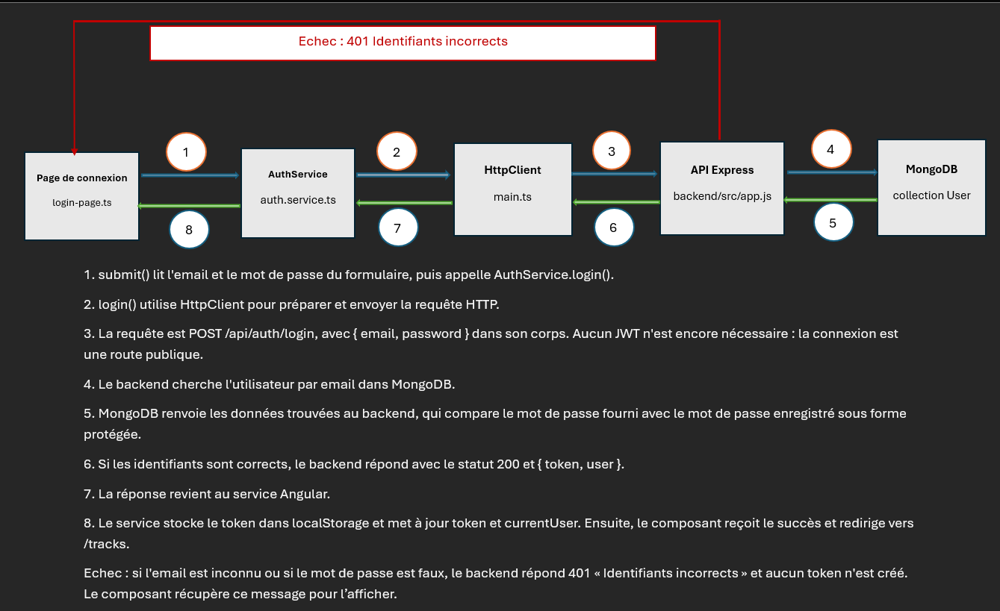
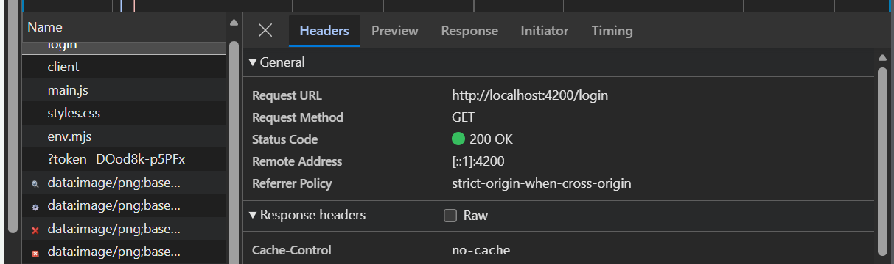
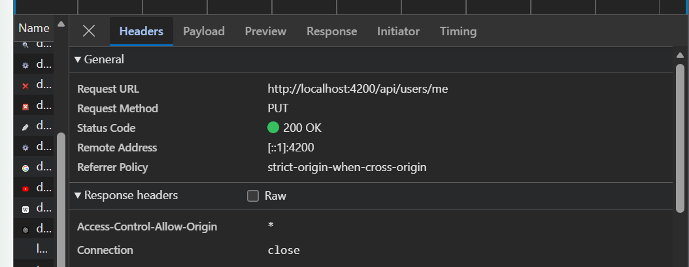
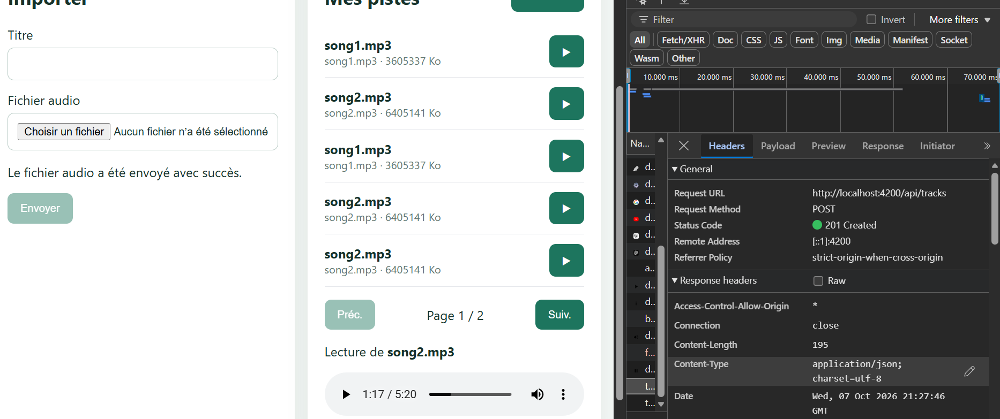
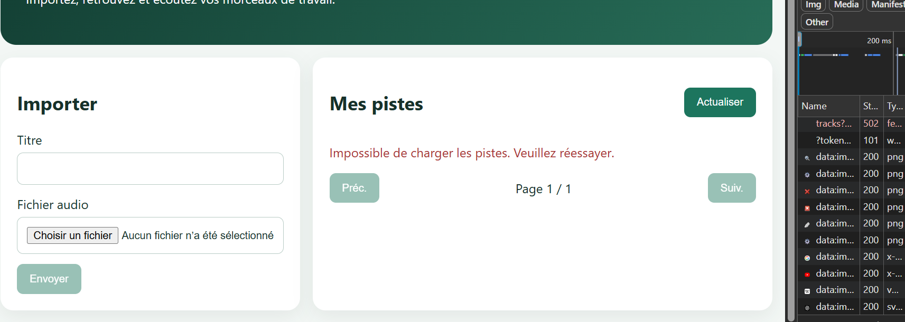

# Rapport d'usage de l'IA - TP1

## Mission 0 — Cartographier l’application

### Outil et modèle d’IA utilisés

- Agent IA : Copilot dans Visual Studio Code (assistant IA utilisant le Copilot SDK).
- Modèles indiqués pendant cette conversation : mai-code-1.1-flash, puis gpt-6-luna après le changement de modèle du 5 octobre 2026.

### Objectif

Identifier le point d’entrée de l’application Angular, la configuration des routes, l’enregistrement du client HTTP, les services responsables de l’authentification et le mécanisme qui ajoute le JWT aux requêtes protégées. Le but est de comprendre le flux complet de connexion avant de modifier le code.

### Prompt principal

« Explique-moi la structure de l’application Angular, repère les fichiers clés du frontend, précise quelles routes sont publiques ou protégées, et décris le flux complet d’une requête de connexion, en m’aidant à comprendre comment le JWT est ajouté sur les requêtes sécurisées. »

### Plan proposé par l’agent

1. Lire le sujet de la mission et le contrat HTTP de l’API.
2. Identifier le composant racine et la configuration du routeur Angular.
3. Repérer le service d’authentification et le signal du token/utilisateur courant.
4. Vérifier le mécanisme du HttpInterceptor qui ajoute l’Authorization header.
5. Résumer le flux de connexion depuis le formulaire jusqu’à la réponse backend.

### Vérifications réalisées

- Lecture des fichiers clés du frontend : `routes.ts`, `main.ts`, `auth.service.ts`, `auth.interceptor.ts` et `auth.guard.ts`, ainsi que du contrat API (`API_CONTRACT.md`).
- Lancement du backend (connecté à MongoDB Atlas) et du frontend, puis observation des requêtes dans l'onglet Network (DevTools).
- Connexion réussie : `POST /api/auth/login` → `200`, avec `token` et `user` dans la réponse.
- Connexion refusée (email inconnu) : `POST /api/auth/login` → `401`, « Identifiants incorrects ».
- Comparaison du schéma avec le code et corrections (voir ci-dessous).

### Erreurs ou propositions rejetées

- Lors du premier test d’un email inconnu, j’ai obtenu un `500` au lieu du `401` attendu. Cause : le backend ne démarrait pas (erreur DNS `querySrv EBADRESP` vers MongoDB Atlas), donc le proxy Angular renvoyait `500`. Après le démarrage du backend, j’ai obtenu `401`.
- Rappel de sécurité respecté : aucun secret JWT, mot de passe, token ou URI MongoDB dans le code ou les captures.

### Fichiers effectivement modifiés

Aucun fichier de code source n’a été modifié pendant cette mission. La mission 0 a consisté à cartographier l’application et à documenter le flux de connexion.

### Preuve de fonctionnement

Le schéma annoté est confirmé par les captures Network : connexion réussie (200 + token et user) et connexion refusée (401). Dans le code, l'intercepteur ajoute `Authorization: Bearer <token>` à chaque requête dès qu'un token existe, et `authGuard` redirige vers `/login` pour `/profile` et `/tracks` sans token.

Le flux principal est donc :
`Formulaire Angular -> AuthService.login() -> POST /api/auth/login -> backend -> JWT + user -> localStorage + signal -> interceptor -> requêtes protégées`.

#### Schéma annoté du flux de connexion

#### Capture Network — connexion réussie

#### Capture Network — connexion échouée

### Ce que je sais maintenant expliquer sans l’agent

- Je sais expliquer l’architecture Angular du frontend, le rôle du routeur Angular et la différence entre routes publiques et routes protégées.
- Je sais expliquer le mécanisme de connexion, le stockage du JWT dans localStorage, la mise à jour du signal currentUser et l’ajout automatique du header Authorization par l'intercepteur.
- Je sais identifier les fichiers principaux du flux : [frontend-starter/src/app/routes.ts](frontend-starter/src/app/routes.ts), [frontend-starter/src/app/shared/services/auth.service.ts](frontend-starter/src/app/shared/services/auth.service.ts), [frontend-starter/src/app/shared/interceptors/auth.interceptor.ts](frontend-starter/src/app/shared/interceptors/auth.interceptor.ts), [frontend-starter/src/main.ts](frontend-starter/src/main.ts).

### Remarque personnelle

Cette mission constitue la base pour les missions suivantes. La compréhension du flux et des responsabilités de chaque couche est essentielle pour faire correctement la connexion, le profil utilisateur et les appels API dans le TP.

## Mission 1 — Inscription, connexion et profil

### Outil et modèle d’IA utilisés

- Agent IA : Copilot dans Visual Studio Code (assistant IA utilisant le Copilot SDK).
- Modèle utilisé pendant cette étape : gpt-6-luna.

### Objectif

Compléter le parcours frontend d’inscription et de connexion, renforcer les validations des formulaires et rendre le profil utilisateur réactif, tout en gardant les appels HTTP dans `AuthService` et sans modifier le backend.

### Prompts principaux

- « Compare le sujet de la Mission 1 avec le code existant et propose un plan. Ne modifie pas encore de fichier. »
- « Ajoute dans register-page une validation de nom d’au moins 2 caractères et de mot de passe d’au moins 8 caractères, affiche les messages en français et bloque l’envoi si le formulaire est invalide. »
- « Charge le profil à l’ouverture, affiche un message de succès ou d’erreur et restaure currentUser après rechargement. »

### Plan proposé par l’agent

1. Vérifier la déconnexion et le menu existants.
2. Gérer les réponses 401 sans transformer en redirection l’erreur d’identifiants incorrects du formulaire de connexion.
3. Vérifier les formulaires réactifs, leurs validateurs, leurs messages et le blocage de soumission invalide.
4. Charger le profil à l’ouverture, rendre les retours visibles et restaurer le signal `currentUser` en relisant `/api/users/me`.

### Modifications réalisées

- Gestion du 401 dans l’intercepteur : une réponse 401 sur une requête protégée nettoie l’état local et redirige vers `/login`. Les routes login/register sont exclues de cette redirection afin de laisser leur formulaire afficher l’erreur de connexion ou d’inscription.
- Les pages utilisateur ne journalisent plus d’objets d’erreur complets.
- Les formulaires de connexion et d’inscription bloquent la soumission s’ils sont invalides, marquent tous les champs comme touchés et affichent les messages de validation en français.
- Le formulaire d’inscription exige un nom d’au moins 2 caractères et un mot de passe d’au moins 8 caractères. Les erreurs serveur sont remplacées par des messages compréhensibles.
- La page profil charge les données à son ouverture, remplit le formulaire, affiche les états de chargement, succès et erreur, et met à jour `currentUser` par l’intermédiaire d’`AuthService`.

### Fichiers effectivement modifiés

- `frontend-starter/src/app/components/app/app.ts`
- `frontend-starter/src/app/components/app/app.html`
- `frontend-starter/src/app/shared/interceptors/auth.interceptor.ts`
- `frontend-starter/src/app/components/login-page/login-page.ts`
- `frontend-starter/src/app/components/login-page/login-page.html`
- `frontend-starter/src/app/components/register-page/register-page.ts`
- `frontend-starter/src/app/components/register-page/register-page.html`
- `frontend-starter/src/app/components/profile-page/profile-page.ts`
- `frontend-starter/src/app/components/profile-page/profile-page.html`
- `frontend-starter/src/app/components/tracks-page/tracks-page.ts`

Aucun fichier de `backend/` n’a été modifié. `app.ts` et `app.html` ont été modifiés pour ajouter le bouton de déconnexion et adapter le menu selon la présence d’un token.

### Vérifications réalisées

- `npm run build` réussi après les changements.
- Tests manuels dans le navigateur (backend Atlas et frontend lancés) :

  - Mauvais mot de passe sur `/login` : « Identifiants incorrects » reste affiché, sans redirection ; le `401` de connexion n’est pas intercepté par le gestionnaire des routes protégées.
  - Faux token : j’ai remplacé `gpc_token` par une valeur invalide dans `localStorage`, puis rechargé la page. `GET /api/users/me` a répondu `401` et l’application m’a renvoyée vers `/login`.
  - Modification du nom du profil : `PUT /api/users/me` → `200` (voir capture).
  - Profil affiché à l’ouverture sans clic.
  - Nom modifié conservé après actualisation de la page.
  - Nom d’un seul caractère refusé avec un message d’erreur.

### Erreurs ou propositions rejetées

- L'étape 3 de l'agent était incomplète : un nom d'un seul caractère passait la validation du formulaire et le serveur renvoyait un message technique en anglais (« User validation failed: name: ... shorter than the minimum allowed length (2) »). J'ai demandé d'ajouter les règles nom ≥ 2 et mot de passe ≥ 8.
- Après cette correction, le formulaire bloquait l'envoi mais n'affichait aucun message ; j'ai demandé l'ajout des messages en français.
- Test du token falsifié : sans rechargement, rien ne changeait, car l'intercepteur lit le Signal en mémoire et non localStorage ; il faut recharger pour que le faux token soit pris en compte.

#### Preuve Network — modification du profil

Capture de la requête de modification du profil dans l’onglet Network :

La capture ne montre pas le JWT. Elle constitue une preuve visuelle de la requête de modification du profil.

### Ce que je sais maintenant expliquer sans l’agent

- Je sais expliquer que le composant utilise `AuthService` et ne fait pas directement d’appel à `HttpClient`.
- Je sais expliquer comment un 401 sur une route protégée nettoie la session et redirige vers la connexion, tandis qu’un 401 de login reste affiché sur la page de connexion.
- Je sais expliquer que la page profil relit `/api/users/me` au chargement et met à jour le signal via `AuthService`.

### Réponses aux questions du TP

- **Routes utilisées par le frontend pour l’authentification et le profil :** `POST /api/auth/register` pour créer un compte, `POST /api/auth/login` pour se connecter, `GET /api/users/me` pour lire le profil et `PUT /api/users/me` pour modifier le nom. Les routes de la bibliothèque audio sont `GET /api/tracks?page=1&limit=5`, `POST /api/tracks` pour l’upload et `GET /api/tracks/:id/audio` pour écouter un fichier.
- **Où se fait la mise à jour du profil ?** Côté Angular, le formulaire est dans `profile-page.html`, le composant `profile-page.ts` appelle `AuthService.update()`, et `auth.service.ts` effectue le `PUT /api/users/me` puis met à jour le Signal `currentUser`. Côté backend, la route `PUT /api/users/me` est définie dans `backend/src/app.js` et met à jour l’utilisateur en base.
- **Quelle est la différence entre Signal et `localStorage` ?** `localStorage` conserve le JWT dans le navigateur entre les rechargements, mais ne met pas directement l’interface à jour. Les Signals `token` et `currentUser` vivent en mémoire pendant l’exécution de l’application et permettent à l’interface de réagir immédiatement ; ils sont recréés au rechargement. Au démarrage, `AuthService` relit le JWT depuis `localStorage`, puis la page profil recharge `currentUser` en appelant `/api/users/me`. Lors du test avec un faux token, il a fallu recharger la page pour que l’application lise cette nouvelle valeur.
- **Comment savoir combien de tokens ont été consommés ?** Je peux consulter les informations d’usage éventuellement présentées par l’interface ou l’offre Copilot utilisée. Aucun nombre de tokens n’est consigné ici, car je n’ai pas de mesure vérifiée pour cette conversation.
- **Qui peut conseiller sur le choix du modèle ?** Le choix dépend de la tâche ; les indications de modèles et les recommandations affichées dans Copilot/VS Code peuvent aider à sélectionner un modèle adapté.

### Remarque personnelle

Cette mission m’a permis de consolider le parcours utilisateur Angular, des validations de formulaire jusqu’à la lecture et à la modification du profil par l’API.

## TP2 — Bibliothèque, upload et lecture audio

### Outil et modèle d’IA utilisés

- Agent IA : Copilot dans Visual Studio Code (assistant IA utilisant le Copilot SDK).
- Modèle utilisé pendant cette étape : gpt-6-luna.

### Objectif

Compléter le frontend de la bibliothèque audio sans modifier le backend ni le contrat HTTP : pagination serveur avec Angular Material, cards accessibles, validation et suivi de l’upload, lecture authentifiée, suppression avec confirmation et filtre par titre.

### Prompts principaux

- « Lis les fichiers du flux audio et explique le choix du fichier, le `FormData`, les requêtes HTTP, le `Blob`, l’`ObjectURL` et l’intercepteur JWT. »
- « Complète les éléments manquants dans le frontend, sans modifier le backend, et attends ma vérification après chaque étape. »
- « Utilise le composant Paginator d’Angular Material. »
- « Ajoute la suppression avec confirmation, le rafraîchissement, le filtre par titre et la progression de l’upload. »

### Modifications réalisées

- **Pagination serveur :** les pistes sont demandées avec `page` et `limit` dans `TrackService.list()`. Le composant Paginator d’Angular Material déclenche une nouvelle requête lors d’un changement de page ou de taille. Les données ne sont pas découpées localement.
- **Cards de bibliothèque :** présentation responsive et accessible du titre, du nom original lorsqu’il diffère, du format, de la taille convertie depuis les octets et de la date au format français. Le morceau en cours est mis en évidence ; les contrôles de lecture et de suppression ont des libellés accessibles.
- **Filtre :** un bouton SVG ouvre le champ de recherche et lui donne le focus. La recherche porte sur le titre de la page courante et ignore les majuscules et les accents. Un bouton efface la recherche.
- **Upload :** contrôle du format et de la limite de 25 Mo côté frontend, messages compréhensibles, protection contre les soumissions répétées, progression lorsque le navigateur fournit le pourcentage, confirmation de succès, remise à zéro du formulaire et rechargement de la première page.
- **Suppression :** appel de `DELETE /api/tracks/:id` après confirmation, message de retour et actualisation de la liste après succès. Si la dernière piste d’une page est supprimée, la page précédente est rechargée.
- **Lecture audio :** affichage du morceau chargé et des erreurs de chargement ou de lecture. L’ancienne `ObjectURL` est révoquée lors du remplacement du lecteur et l’URL finale à la destruction du composant.
- **Messages de succès :** les confirmations d’upload et de suppression disparaissent après environ quatre secondes ou dès une nouvelle action ; le minuteur est nettoyé à la destruction du composant.
- Le filtre, l’upload, la pagination, la lecture et la suppression restent dans le frontend. Aucun endpoint, schéma de données ou comportement backend n’a été modifié.

### Fichiers effectivement modifiés pour le TP2

- `frontend-starter/src/app/components/tracks-page/tracks-page.ts`
- `frontend-starter/src/app/components/tracks-page/tracks-page.html`
- `frontend-starter/src/app/components/tracks-page/tracks-page.css`
- `frontend-starter/src/app/shared/services/track.service.ts`
- `frontend-starter/src/main.ts`
- `frontend-starter/package.json`
- `frontend-starter/package-lock.json`

### Vérifications réalisées

- `npm run build` dans `frontend-starter` : compilation Angular réussie après les changements.
- Diagnostics ciblés du template et du composant : aucune erreur signalée.
- Sélection d’un fichier PDF : le frontend affiche le message de format non accepté et bloque l’envoi.
- Arrêt du backend puis actualisation de la page : le frontend affiche un message d’erreur de chargement au lieu de présenter l’état vide comme si aucune piste n’existait.
- Une capture existante montre la requête multipart `POST /api/tracks` avec le statut `201 Created`. Une autre montre le refus d’un fichier au format non accepté.
- Les captures existantes ont été prises avant la dernière finition visuelle des cards ; elles ne représentent donc pas nécessairement la présentation finale.

### Preuves disponibles

#### Upload réussi dans Network

La capture montre une requête `POST /api/tracks` retournant `201 Created`.

#### Refus d’un format non accepté

La capture montre le message frontend affiché après la sélection d’un fichier non accepté.

#### Erreur lorsque le serveur est indisponible

### Explications techniques

- **Flux d’upload :** le composant `tracks-page.ts`, dans `choose()`, reçoit le fichier sélectionné et le valide. `upload()` appelle ensuite `TrackService.upload()`. Dans `track.service.ts`, le service construit un `FormData` avec exactement les champs `audio` et `title`, puis effectue le `POST /api/tracks`. Le serveur vérifie le fichier et enregistre le fichier et ses métadonnées.
- **Flux de lecture :** `play(track)` dans `tracks-page.ts` appelle `TrackService.audio(track.id)`. Le service utilise `HttpClient` avec `responseType: 'blob'`. L’intercepteur ajoute le JWT à cette requête HttpClient. Après la réponse, le composant crée une URL locale avec `URL.createObjectURL(blob)` et la fournit à la balise `<audio>`.
- **Pourquoi pas une URL directement dans `src` ?** Une requête lancée par le navigateur depuis l’élément `<audio>` ne passe pas par l’intercepteur Angular ; elle ne reçoit donc pas automatiquement le header `Authorization` ajouté par celui-ci.
- **Validation frontend et backend :** les vérifications côté frontend permettent d’informer rapidement l’utilisateur et d’éviter une requête inutile. Elles ne sont pas une protection : un client peut être contourné. La validation backend reste indispensable.

### Réponses aux questions sur mémoire, buffering et streaming

- **Le backend doit-il charger tout le fichier en mémoire ?** Non. La route `GET /api/tracks/:id/audio` retrouve le chemin du fichier puis appelle `res.sendFile(audioPath)`. Express peut transférer le fichier depuis le disque progressivement au lieu de charger son contenu entier dans un grand tampon JavaScript.
- **Quand le composant reçoit-il le `Blob` ?** Avec `HttpClient` et `responseType: 'blob'`, le composant reçoit généralement la réponse `Blob` lorsque le corps complet de cette réponse a été téléchargé. Il crée ensuite l’`ObjectURL` pour le lecteur.
- **Les 100 morceaux audio sont-ils téléchargés avec la liste ?** Non. `GET /api/tracks` renvoie les métadonnées paginées ; les données audio sont demandées séparément par `GET /api/tracks/:id/audio` lorsqu’on choisit une piste.
- **Quelle différence avec 100 éléments `<audio>` ayant directement une URL ?** Chaque élément pourrait déclencher sa propre requête audio, suivant le comportement de chargement et de prélecture du navigateur ; cela multiplierait les requêtes et pourrait accroître le trafic. Dans cette application, un clic explicite déclenche plutôt le téléchargement du seul morceau choisi sous forme de `Blob`.
- **Pourquoi révoquer l’`ObjectURL` ?** L’URL créée par `URL.createObjectURL()` maintient une référence aux données du `Blob`. `URL.revokeObjectURL()` libère cette ressource lorsque le lecteur est remplacé ou détruit.
- **Téléchargement, buffering et streaming :** le téléchargement du `Blob` via `HttpClient` attend généralement que le fichier audio soit entièrement reçu avant que le composant puisse le donner au lecteur. Le buffering du navigateur consiste à accumuler des données pour permettre une lecture fluide. Le streaming permet de recevoir et lire progressivement des données pendant que le transfert continue ; l’utilisation actuelle d’un `Blob` via `HttpClient` n’offre pas cette lecture progressive au lecteur.

### Points restant à capturer pour la remise

- La capture Network d’un changement de page montrant le paramètre `page` (et éventuellement `limit`) transmis à `GET /api/tracks`.
- Une capture Network ou une démonstration confirmant la réussite d’une lecture audio authentifiée. La capture actuelle `erreur_lecture_audio.png` montre une réponse `502` et ne constitue pas une preuve de lecture réussie.

### Remarque personnelle

Ce TP m’a permis de comprendre que la pagination est effectuée côté serveur, que les métadonnées et les octets audio sont récupérés par des requêtes distinctes, et que le `Blob`/`ObjectURL` permet au lecteur de consommer une réponse audio authentifiée avec le JWT.
